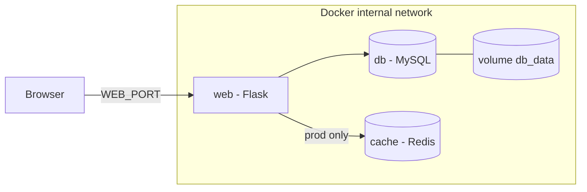

# Multi-environment deployment with Docker

Practice 1 – Deployment of multi-environment applications  
Universitat de les Illes Balears (UIB)  
Author: Paula Cristina Morro Negre

## 1. Project description

This project is a small web service that runs in Docker containers. It has three parts:

- **web**: a Flask app (Python). It shows a Pokédex of starter Pokémon and a list of "favorite Pokémon" that the user can add.
- **db**: a MySQL 8.0 database. It stores the favorite Pokémon.
- **cache**: a Redis server. It speeds up the list of favorites by keeping a copy in memory. It only exists in the production environment.

The service can run in two environments, **dev** and **prod**, each with its own Compose file and its own `.env` file.

The web page shows the status of the web, the database and the cache. 

## 2. Project structure

```
.
├── docker-compose.dev.yml     # dev environment (web + db)
├── docker-compose.prod.yml    # prod environment (web + db + cache)
├── .env.dev                   # variables for dev
├── .env.prod                  # variables for prod
├── Makefile                   # commands to build, start, stop and test
├── .gitignore                 # keeps the .env files out of git
└── web/
    ├── Dockerfile             # image of the web app (with healthcheck)
    ├── .dockerignore
    ├── requirements.txt       # Python dependencies
    ├── app.py                 # Flask app: /, /status, /favoritos
    └── index.html             # web page (Pokédex + service status + favorites)
```

## 3. Architecture



- All services are in the same Docker network (`internal_net`). They find each other by service name (`db`, `cache`).
- Only `web` publishes a port to the host. MySQL and Redis have no `ports:` section, so they cannot be reached from outside Docker.
- MySQL data is saved in a Docker volume, so it is not lost when the container is removed.

## 4. Environments

| | dev | prod |
|---|---|---|
| Compose file | `docker-compose.dev.yml` | `docker-compose.prod.yml` |
| Variables file | `.env.dev` | `.env.prod` |
| Services | web, db | web, db, cache |
| Cache | Not used (the page shows “Not applicable (dev)”) | Redis with password, entries expire after 60 s |
| Web port | 5000 | 8080 |
| Restart policy | none | `unless-stopped` |
| Docker project name | `practica-dev` | `practica-prod` |

Both environments use the same MySQL version, but each one has its **own database container, its own volume and its own passwords**. Data created in dev never appears in prod. Because the project names are different, both environments can run at the same time.

## 5. Requirements

- Docker with Compose v2 (`docker compose version` should work)
- `make`
- `curl` (to run the tests)

The Makefile uses shell commands, so on Windows you must run it from the Ubuntu console via WSL.

## 6. Installation and run (step by step)

**1. Clone the repository**

```bash
git clone <repository-url>
cd <repository-folder>
```

**2. Create the environment files**

The real `.env` files are not in the repository, so you have to create them in the root folder of the project.

File `.env.dev`:

```
WEB_PORT=5000
DB_HOST=db
MYSQL_ROOT_PASSWORD=change_root_dev
MYSQL_DATABASE=practica
MYSQL_USER=app
MYSQL_PASSWORD=change_dev
```

File `.env.prod`:

```
WEB_PORT=8080
DB_HOST=db
MYSQL_ROOT_PASSWORD=change_root_prod
MYSQL_DATABASE=practica
MYSQL_USER=app
MYSQL_PASSWORD=change_prod
REDIS_HOST=cache
REDIS_PASSWORD=change_redis_prod
```
Change the passwords. Use different passwords in each file.

The variables are:

| Variable | Meaning | dev | prod |
|---|---|---|---|
| `WEB_PORT` | Port of your computer where the web is available | yes | yes |
| `DB_HOST` | Name of the database service (`db`) | yes | yes |
| `MYSQL_ROOT_PASSWORD` | MySQL root password | yes | yes |
| `MYSQL_DATABASE` | Database name | yes | yes |
| `MYSQL_USER` | Database user used by the app | yes | yes |
| `MYSQL_PASSWORD` | Password of that user | yes | yes |
| `REDIS_HOST` | Name of the cache service (`cache`) | no | yes |
| `REDIS_PASSWORD` | Redis password | no | yes |

**3. Check the requirements**

```bash
make setup
```

This command checks that Docker is installed and running, and that the files .env.dev and .env.prod exist.

**4. Start an environment**

```bash
make up-dev      # open http://localhost:5000
# or
make up-prod     # open http://localhost:8080
```

Each command builds the images and starts the containers. Compose starts `db` (and `cache` in prod) first and starts `web` only when they are healthy, so the first start can take about 30 seconds. 

**5. Stop**

```bash
make down-dev
# or
make down-prod
```
This stops and removes the containers and the network. The data stays in the volume.

If you also want to delete the data (the volume), use:

```bash
make clean-dev     
# or
make clean-prod     
```

## 7. Makefile commands

All commands work for both environments. Add `-dev` or `-prod` to the end of the command name.

If you do not add a suffix, the command uses `dev` (`make up` is the same as `make up-dev`). Use the suffix always, to avoid mistakes. The only commands without a suffix is `make setup`, `make ps` and `make check-ports`.

| Command | What it does |
|---|---|
| `make setup` | Checks that Docker is installed and running, and checks if `.env.dev` and `.env.prod` exist |
| `make build-dev` / `make build-prod` | Builds the images |
| `make up-dev` / `make up-prod` | Builds the images and starts the containers |
| `make ps` | Check the health status of the containers |
| `make status-dev` / `make status-prod` | Check de connections  |
| `make favoritos-dev` / `make favoritos-prod` | Displays the list of favorites and the origin |
| `make check-ports` | Shows a list of active Docker ports and tests the network to prove that the web ports (5000, 8080) are open, while the database (3306) and cache (6379) ports are safely blocked from the outside |
| `make down-dev` / `make down-prod` | Stops and removes the containers and the network. **Data is kept** |
| `make clean-dev` / `make clean-prod` | Same as `down`, but also **deletes the volume** (data is lost) |
| `make add-db-dev` / `make add-db-prod` | Inserts three rows (Snorlax, Charmander, Squirtle) in the table `favoritos` |
| `make show-db-dev` / `make show-db-prod` | Shows the content of the table `favoritos` (it also proves that the connection to MySQL works) |
| `make show-vol-dev` / `make show-vol-prod` | Shows the volumes that exist in Docker |
| `make stop-db-dev` / `make stop-db-prod` / `make start-db-dev` / `make start-db-prod` | Stops / starts only the database (to test the status of the app) |
| `make show-cache-prod` | Shows what Redis has saved under the key `favoritos` |
| `make stop-cache-prod` / `make start-cache-prod` | Stops / starts only the cache |

The cache commands (`show-cache`, `stop-cache`, `start-cache`) only work in prod, because dev has no cache.

The Makefile also sets the permissions of `.env.dev` and `.env.prod` to `600` (only the owner can read and write them).

The Makefile has a rule `%-dev` and `%-prod`. It runs the command again with `ENV=dev` or `ENV=prod`. The variable `ENV` chooses the Compose file (`docker-compose.<ENV>.yml`), the env file (`.env.<ENV>`) and the project name (`practica-<ENV>`), so both environments can run at the same time without mixing containers or volumes.

## 8. Healthchecks

A healthcheck is a command that Docker runs every few seconds to know if a container works. Docker marks the container as `healthy` or `unhealthy`.

| Service | Where it is defined | Check | Interval |
|---|---|---|---|
| web | `web/Dockerfile` | Python makes a request to `http://localhost:5000/status` and fails if there is no answer | 15 s |
| db | Compose file | `mysqladmin ping` using the root password from the container environment | 10 s |
| cache | `docker-compose.prod.yml` | `redis-cli ping` with password, and it must answer `PONG` | 10 s |

Other details:

- `web` has `depends_on` with `condition: service_healthy`. It only starts when `db` (and `cache` in prod) are healthy. This avoids errors when MySQL is still starting.
- In prod, the three services have `restart: unless-stopped`.
- The endpoint `/status` makes a real connection to MySQL and a real `PING` to Redis each time it is called. It returns a JSON like this:

```json
{"cache": "Connected", "database": "Connected", "environment": "prod"}
```

  Each service can be `Connected` or `Disconnected`. In dev the cache is `Not applicable (dev)`.
- `/status` always answers with HTTP 200, even if MySQL or Redis are down. That is why the Docker healthcheck of the web only checks that the app answers, and Docker does not restart the web for a problem that is not its own. The problem is shown in the JSON and in the page.
- The web page calls `/status` every 5 seconds and updates the colors (green = connected, red = disconnected, gray = not used).

## 9. Cache (prod)

The endpoint `GET /favoritos` works like this:

1. If Redis is available, it looks for the list there. If it finds it, it answers with `"origen": "cache (Redis)"`.
2. If not, it reads the list from MySQL, saves a copy in Redis for 60 seconds and answers with `"origen": "base de datos (MySQL)"`.
3. When a new favorite is added (`POST /favoritos`), the copy in Redis is deleted, so the next read gets fresh data.

If Redis stops, the app keeps working and reads from MySQL.

The web page shows the origin of the data under the "Mis Pokémon favoritos" title. You can also see the saved copy with `make show-cache-prod`.

## 10. Tests and results

### Test 1: containers are healthy

```bash
make ps
```

**Result:**
```bash
docker ps --format "table {{.Names}}\t{{.Status}}"
NAMES                   STATUS
practica-dev-web-1      Up 15 seconds (healthy)
practica-dev-db-1       Up 59 seconds (healthy)
practica-prod-web-1     Up 4 minutes (healthy)
practica-prod-cache-1   Up 5 minutes (healthy)
practica-prod-db-1      Up 5 minutes (healthy)
```

### Test 2: status endpoint

```bash
make status-dev
```

**Result:**
```bash
make status ENV=dev
curl http://localhost:5000/status
{"cache":"Not applicable (dev)","database":"Connected","environment":"dev"}
```

```bash
make status-prod
```

**Result:**
```bash
make status ENV=prod
make[1]: Entering directory '/home/paula/docker-multi-environment-deployment'
curl http://localhost:8080/status
{"cache":"Connected","database":"Connected","environment":"prod"}
```

### Test 3: connection to the database and automatic table

```bash
make add-db-dev
make show-db-dev
```

**Result:**
```bash
+----+------------+---------------------+
| id | nombre     | creado              |
+----+------------+---------------------+
|  1 | Snorlax    | 2026-10-17 13:30:22 |
|  2 | Charmander | 2026-10-17 13:30:22 |
|  3 | Squirtle   | 2026-10-17 13:30:22 |
+----+------------+---------------------+
```

### Test 4: dev and prod are separated

```bash
make show-db-dev    
```

**Result:**
```bash
+----+------------+---------------------+
| id | nombre     | creado              |
+----+------------+---------------------+
|  1 | Snorlax    | 2026-10-17 13:30:22 |
|  2 | Charmander | 2026-10-17 13:30:22 |
|  3 | Squirtle   | 2026-10-17 13:30:22 |
+----+------------+---------------------+
```

```bash
make show-db-prod    
```

**Result:**
```bash

```

### Test 5: data persistence

```bash
make show-db-dev     # data before
```

**Result:**
```bash
+----+------------+---------------------+
| id | nombre     | creado              |
+----+------------+---------------------+
|  1 | Snorlax    | 2026-10-17 13:30:22 |
|  2 | Charmander | 2026-10-17 13:30:22 |
|  3 | Squirtle   | 2026-10-17 13:30:22 |
+----+------------+---------------------+
```

```bash
make down-dev        # containers and network are removed
```

```bash
make up-dev          # new containers
```

```bash
make show-db-dev     # data after
```

**Result:**
```bash
+----+------------+---------------------+
| id | nombre     | creado              |
+----+------------+---------------------+
|  1 | Snorlax    | 2026-10-17 13:30:22 |
|  2 | Charmander | 2026-10-17 13:30:22 |
|  3 | Squirtle   | 2026-10-17 13:30:22 |
+----+------------+---------------------+
```

To see the opposite case:

```bash
make clean-dev     # also deletes the volume
```

```bash
make up-dev         
```

```bash
make show-db-dev  
```

**Result:**
```bash

```

### Test 6: status changes when a service stops

```bash
make stop-db-dev
```

```bash
make status-dev        
```

**Result:**
```bash
{"cache":"Not applicable (dev)","database":"Disconnected","environment":"dev"}
```

```bash
make start-db-dev  
```

### Test 7: only the web port is exposed

```bash
make check-ports
```

**Result:**
```bash
docker ps --format "table {{.Names}}\t{{.Ports}}"
NAMES                   PORTS
practica-dev-web-1      0.0.0.0:5000->5000/tcp, [::]:5000->5000/tcp
practica-prod-web-1     0.0.0.0:8080->5000/tcp, [::]:8080->5000/tcp
practica-prod-cache-1   6379/tcp
practica-prod-db-1      3306/tcp, 33060/tcp
nc -zv localhost 5000
Connection to localhost (127.0.0.1) 5000 port [tcp/*] succeeded!
nc -zv localhost 8080
Connection to localhost (127.0.0.1) 8080 port [tcp/http-alt] succeeded!
nc -zv localhost 3306
nc: connect to localhost (127.0.0.1) port 3306 (tcp) failed: Connection refused
make: [Makefile:43: check-ports] Error 1 (ignored)
nc -zv localhost 6379
nc: connect to localhost (127.0.0.1) port 6379 (tcp) failed: Connection refused
make: [Makefile:44: check-ports] Error 1 (ignored)
```

### Test 8: cache works (prod)

```bash
make add-db-prod
```

```bash
make show-cache-prod  # empty, nothing is cached yet 
```

**Result:**
```bash
(nil)
```

```bash
make favoritos-prod # origin: base de datos (MySQL) 
```

**Result:**
```bash
{"items":[{"id":3,"nombre":"Squirtle"},{"id":2,"nombre":"Charmander"},{"id":1,"nombre":"Snorlax"}],"origen":"base de datos (MySQL)"}
```

```bash
make show-cache-prod # now Redis has a copy of the list
```

**Result:**
```bash
"[{\"id\": 3, \"nombre\": \"Squirtle\"}, {\"id\": 2, \"nombre\": \"Charmander\"}, {\"id\": 1, \"nombre\": \"Snorlax\"}]"
```

```bash
make favoritos-prod # origin: cache (Redis)
```

**Result:**
```bash
{"items":[{"id":3,"nombre":"Squirtle"},{"id":2,"nombre":"Charmander"},{"id":1,"nombre":"Snorlax"}],"origen":"cache (Redis)"}
```

## 11. Security measures

- **No hardcoded credentials.** Passwords are only in the `.env` files. The code and the YML files only use variables like `${MYSQL_PASSWORD}`.
- **`.env` files are not in git.** `.gitignore` excludes them. 
- **Minimum permissions.** The Makefile sets the permissions of `.env.dev` and `.env.prod` to `600`, so only the owner can read and write them. You can check it with `ls -la .env.dev .env.prod`, each line must start with `-rw-------`.
- **No unnecessary ports.** Only the web port is published. MySQL and Redis are only reachable inside `internal_net`.
- **Non-root user.** The web container runs with a normal user (`appuser`), not as root.
- **Redis has a password.** It is set with `--requirepass`.

## 12. Troubleshooting

- **`port is already allocated`**: another program uses that port. Change `WEB_PORT` in the `.env` file.
- **`make setup` says Docker is not installed or not running**: install Docker, or start Docker Desktop / the Docker service, and run the command again.
- **I changed the database password but it does not work**: MySQL only reads the password the first time it creates the volume. Run `make clean-dev` (or `clean-prod`) and start again (this deletes the data).

## 13. Use of AI tools

Claude Sonnet 5.5 (Anthropic) was used for the implementation of the frontend (which was not the point of the practice), explication of Docker and makefile concepts and help with writing in English.
